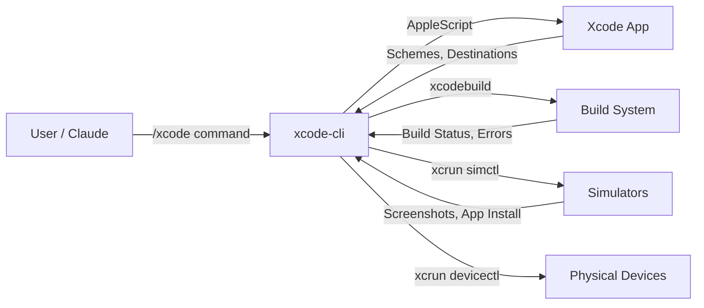

# xcode-cli

Agent-operable CLI for Xcode on macOS. Build, test, run, clean, archive Xcode projects, manage simulators and physical devices, inspect build results -- all from the command line or an interactive REPL.

Designed as a Claude Code plugin for controlling Xcode programmatically.

## Requirements

- macOS with Xcode installed
- Xcode Command Line Tools (`xcode-select --install`)
- Python 3.10+

## Installation

```bash
cd agent-harness
python3 -m venv .venv
source .venv/bin/activate
pip install -e .
```

## Usage

### One-shot commands

```bash
# Workspace operations
xcode-cli workspace list
xcode-cli workspace open ~/Developer/MyApp/MyApp.xcodeproj
xcode-cli workspace schemes
xcode-cli workspace destinations
xcode-cli workspace projects
xcode-cli workspace targets
xcode-cli workspace settings --target MyApp --config Debug
xcode-cli workspace active

# Build operations
xcode-cli build build --scheme MyApp
xcode-cli build run --scheme MyApp
xcode-cli build test --scheme MyApp --destination "platform=iOS Simulator,name=iPhone 16"
xcode-cli build clean --scheme MyApp
xcode-cli build stop
xcode-cli build archive --scheme MyApp --output ~/Desktop/MyApp.xcarchive
xcode-cli build status
xcode-cli build errors
xcode-cli build warnings
xcode-cli build test-failures
xcode-cli build log

# Simulator management
xcode-cli simulator list --available
xcode-cli simulator boot "iPhone 16"
xcode-cli simulator shutdown "iPhone 16"
xcode-cli simulator install "iPhone 16" /path/to/MyApp.app
xcode-cli simulator launch "iPhone 16" com.example.myapp
xcode-cli simulator screenshot "iPhone 16" ~/Desktop/screenshot.png
xcode-cli simulator create "My Sim" "com.apple.CoreSimulator.SimDeviceType.iPhone-16" "com.apple.CoreSimulator.SimRuntime.iOS-18-0"
xcode-cli simulator delete "My Sim"
xcode-cli simulator types
xcode-cli simulator runtimes

# Physical devices
xcode-cli device list
xcode-cli device info <udid>

# Editor
xcode-cli editor file
xcode-cli editor text
xcode-cli editor selection
xcode-cli editor goto 42
xcode-cli editor open /path/to/file.swift

# Session
xcode-cli session status
```

### JSON output

Add `--json` before any command for machine-readable output:

```bash
xcode-cli --json workspace schemes
xcode-cli --json build build --scheme MyApp
xcode-cli --json simulator list --available
```

### Interactive REPL

Run without arguments to enter the REPL:

```bash
xcode-cli
```

The REPL provides the same commands with tab completion and command history.

## Architecture

```
xcode_cli/
  __init__.py          # Package version
  __main__.py          # python -m xcode_cli entry point
  xcode_cli.py         # Click CLI + REPL
  utils/
    xcode_backend.py   # osascript, xcodebuild, xcrun wrappers
    repl_skin.py       # Terminal UI skin
  core/
    workspace.py       # Workspace/project/scheme operations (AppleScript)
    build.py           # Build/test/clean/archive (xcodebuild + AppleScript)
    simulator.py       # Simulator management (xcrun simctl)
    devices.py         # Physical device management (xcrun devicectl)
    editor.py          # Editor/document operations (AppleScript)
    session.py         # Session state management
  tests/
    __init__.py
```

### Data Flow



## Backend Strategy

- **Workspace queries** (schemes, destinations, active state): AppleScript via `tell application "Xcode"`
- **Build/test/clean/archive**: `xcodebuild` CLI (more reliable output parsing)
- **Build status/errors/warnings**: AppleScript scheme action results
- **Simulator management**: `xcrun simctl`
- **Physical devices**: `xcrun devicectl`
- **Editor operations**: AppleScript text document model

## Claude Code Plugin

This repository is structured as a Claude Code plugin with:
- `.claude-plugin/plugin.json` -- Plugin metadata
- `commands/xcode.md` -- `/xcode` slash command
- `skills/xcode/SKILL.md` -- Skill definition with triggers

## License

MIT -- Marcel R. G. Berger
